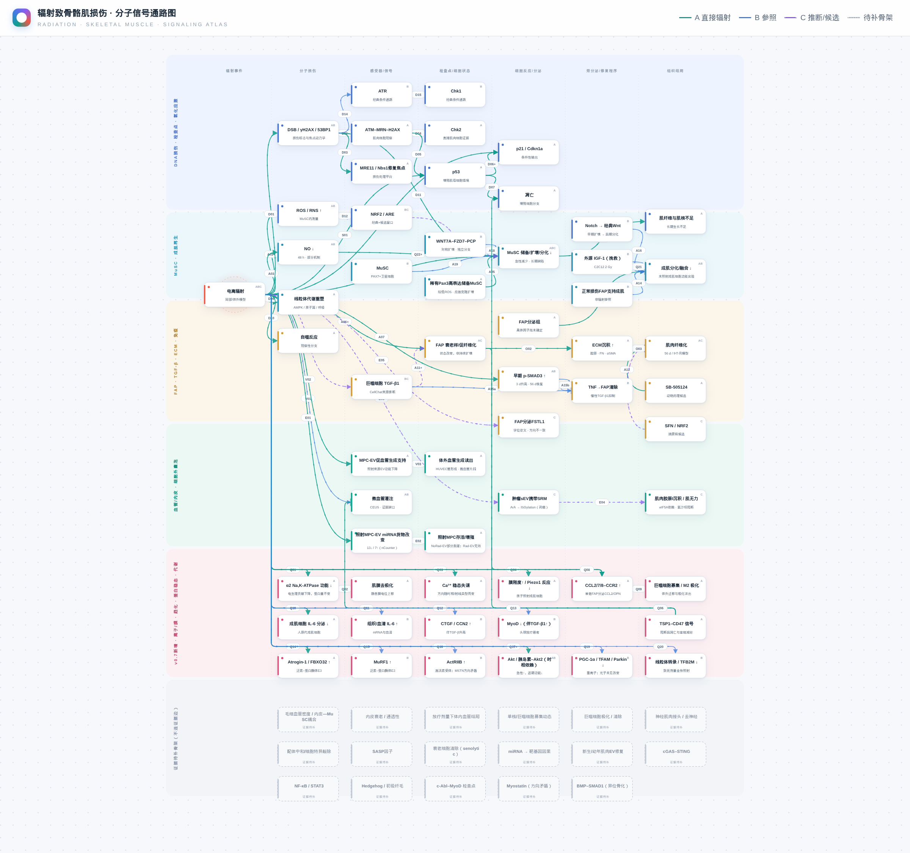

# 肌肉信号图谱 v0.3 – v0.7：辐射损伤、修复障碍与纤维化

[](https://tuanziding.github.io/radiation-muscle-pathway/)

**在线交互分子通路图：<https://tuanziding.github.io/radiation-muscle-pathway/>**（单文件 HTML，也可下载 [`docs/pathway-v0.7.html`](docs/pathway-v0.7.html) 离线双击打开）

## EV 干预通路图 v0.1（2026-10-21，独立页面）

- **在线**：<https://tuanziding.github.io/radiation-muscle-pathway/ev-intervention-v0.1.html>（单文件，可离线打开 [`docs/ev-intervention-v0.1.html`](docs/ev-intervention-v0.1.html)）。
- **范围**：用细胞外囊泡（EV）干预骨骼肌损伤的原始研究。筛 658 个标题、读 157 篇摘要和 32 篇全文，纳入 132 篇（A 2 / B 111 / C 19）；图中按 7 个机制泳道绘出 52 个节点、42 条带文献的关系。A = 辐射模型直接证据，B = 心脏毒素/BaCl₂/萎缩/缺血/mdx 等非辐射模型的在体 EV 干预参照，C = 仅体外/候选；【致病】边为 EV 介导的损伤机制（如受照肿瘤 sEV）。
- **关键缺口**：尚无“在体辐射骨骼肌损伤 + 外源 EV + 功能终点”研究；唯一直接研究（PMID 40835994）为体外，且受照细胞来源 EV 丧失促血管活性。
- 数据 `data/ev-intervention-v0.1.json`，构建 `scripts/build-ev-v01.mjs`（模板 `scripts/pathway-template-ev.html`），筛查报告与纳入/排除表见 [`docs/ev-v0.1/`](docs/ev-v0.1/ev-report-v01.md)。

## v0.7 更新（2026-10-21）：系统文献筛查补全

- **系统筛查**：PubMed 按 8 组通路关键词 + 2023–2026 全量 + 2 轮补充检索，去重后筛 891 个标题、精读约 95 篇摘要、18 篇全文；纳入 53 篇（A 15 / B 26 / C 12），排除 227 篇并逐条记录理由。只纳入直接照射骨骼肌或肌源细胞的原始研究；所有 A 级均已读全文。检索式、纳入表、排除表与报告见 [`docs/v0.7/`](docs/v0.7/screen-report-v07.md)。
- **新增泳道“离子/膜 · 趋化 · 蛋白稳态 · 代谢”**：α2 Na,K-ATPase 功能↓→肌膜去极化（哇巴因可预防，A）、Ca²⁺ 稳态失调（A）、质子照射致 Piezo1 反应↓（A）、TSP1–CD47（阻断后凋亡减少、灌注改善，A）、CCL2/7/8–CCR2 及衰老 FAP→CCL2/OPN→巨噬细胞募集（A）、Atrogin-1↑（A）、MuRF1↑、ActRIIB↑、Akt/胰岛素–Akt2（时相依赖）、PGC-1α/TFAM/Parkin↓（重离子）、线粒体转录↓、IL-6（组织↑、成肌细胞分泌↓）、CTGF↑、MyoD↓（B）；外源 IGF-1 挽救分化（B）；NO 供体挽救卫星细胞增殖新增 A 级证据。
- **新增骨架（证据不足或方向矛盾，不连证据边）**：神经肌肉接头/去神经、cGAS–STING（0 篇）、NF-κB/STAT3、Hedgehog/初级纤毛、c-Abl–MyoD、Myostatin（方向矛盾）、BMP–SMAD1。
- **数据**：`data/atlas-v0.5.json` 保持不变；新增证据写在 `data/additions-v0.7.json`，由 `scripts/merge-registry-v07.mjs` 合并为 `data/atlas-v0.7.json`，再由 `scripts/build-pathway-v07.mjs` 生成页面。新泳道连线改为沿列间走线、从节点上方进入，避免穿过其他节点。
- **验证**：`scripts/verify-pathway-v07.mjs` 113 项检查（新增节点点击、PubMed 可追溯、Myostatin 保持骨架等），已替换 CI 中的 v0.6 检查。v0.6 页面保留在 `docs/pathway-v0.6.html`。
- **局限**：基础检索约 3,700 条 2023 年前记录未逐条筛查；cGAS–STING、HIF-1α、YAP、NLRP3、铁死亡、PDGFRα 在直接照射肌肉中未检索到原始证据。

## v0.6 更新（2026-10-21）

- **统一分子信号通路图**：把 v0.5 六个专题的 50 个节点、49 条证据关系合并到一张图，按“辐射 → 分子损伤 → 感受器/信号 → 检查点/细胞状态 → 分泌/旁分泌 → 组织结局”从左到右排列，分 DNA/检查点、MuSC、FAP–TGF-β–ECM–免疫、血管/EV 四条泳道，底部为“证据待补”骨架。
- **真实性约束**：图上每个节点、连线、等级、剂量和文献都由 `data/atlas-v0.5.json` 自动生成，不手写、不由图像模型生成；同一实体在多个专题出现时合并为一个节点（如 p53、p21、FAP），同一关系在多个专题出现时保留各自编号（如 D06 + S02）。
- **交互**：点节点看所有相连证据；点连线看模型、剂量（含 EQD2）、时间点、方法、功能读出、解释边界和 PubMed 链接；“仅A级”“放疗相关”筛选；中英文切换；拖动/缩放。
- **验证**：`scripts/verify-pathway-v06.mjs` 81 项检查（含真实鼠标点击节点/连线、证据边与注册表一一对应、等级不变、骨架无证据边、A08/A10 不出现、X01–X08 保留、三种视口无横向溢出、无页面错误），已加入 CI。
- （v0.6 时）GitHub Pages 首页改为 v0.6 通路图；v0.5 教学图谱保留在 `docs/atlas/index.html`，页面右上角可切换。

一个中文优先、可切换英文的交互式教学图谱。页面按六个阶段演示电离辐射后的MuSC直接损伤、FAP状态改变、免疫和基质通讯、成肌障碍、长期结局及可研究的修复窗口。设计参考 Human Atlas 的探索式布局，并以肌纤维—基底膜—间质的空间关系组织节点。

独立仓库：[TUANZIDING/radiation-muscle-pathway](https://github.com/TUANZIDING/radiation-muscle-pathway)。


## v0.5 更新（2026-10-20）

- **剂量层**：每条证据边结构化记录照射方案，体内方案计算 EQD2（α/β = 3 Gy），界面可按“放疗相关 / 高剂量·事故级 / 体外 / 分次未记录”筛选。
- **四个骨架专题**：血管/内皮、免疫/巨噬细胞、衰老/p21、EV/miRNA。已核查证据画成 A/B/C 边，缺口用灰色虚框“证据待补”节点标出，验证脚本禁止骨架节点连证据边。
- **新文献**：照射 MPC 的 EV（Sci Rep 2025，PMID 40835994，A 级体外）；肿瘤 sEV-SRM 致放疗后肌无力（Cell Metab 2025，PMID 40541182，C 级：全文核查确认依赖肿瘤，肌肉未直接受照）；FAP FSTL1（2025 硕士论文，C 级）。新增排除关系 X05–X08。
- **统一注册表与导出**：`data/atlas-v0.5.json`（schema：`data/atlas-schema-v0.5.json`）、`exports/evidence-table-v0.5.csv`、`exports/atlas-v0.5.sbgn`（SBGN-ML Activity Flow，可导入 MINERVA/Newt）。
- **CI**：`.github/workflows/verify.yml`。

```sh
node build-v05.mjs && node scripts/export-v05.mjs && node verify-v05.mjs
```

详见 [docs/v0.5/README.md](docs/v0.5/README.md) 与 [docs/pathway-evidence-v0.5.md](docs/pathway-evidence-v0.5.md)。v0.4 构建产物归档于 `history/v0.4/atlas-index.html`。

### 引用

> Ding H. Radiation Muscle Pathway Atlas (v0.5). GitHub: TUANZIDING/radiation-muscle-pathway. DOI: 待 Zenodo 发布后填写.

## 打开与运行

`index.html` 是构建后的单文件页面，可离线打开。若从父目录启动本地服务：

```sh
python3 -m http.server 8094 --bind 127.0.0.1
```

访问 `http://127.0.0.1:8094/radiation-muscle-pathway/?v=0.3`。

v0.4 机制图谱入口为 `http://127.0.0.1:8094/radiation-muscle-pathway/atlas/index.html#overview`。GitHub Pages 发布入口为 `docs/index.html`；启用 Pages 后可直接访问 `https://TUANZIDING.github.io/radiation-muscle-pathway/`。

## 交互

- 播放、暂停、继续、重播、前后阶段、拖动时间轴及0.5×–2×速度。
- 六阶段进度与当前阶段讲解；总长34秒，仅表示教学顺序。
- 点击节点查看相关关系；点击箭头查看文献、模型、剂量、时间点、证据等级和限制。
- 中文/英文切换保留当前播放位置、筛选和选择状态。
- 按全部关系、直接辐射、一般修复参照、推断与候选筛选。
- 组织图谱与通路网络两种视图；支持减少动画。
- 移动端按当前阶段调整图谱视窗，播放控件保持在图谱下方。

## 科学边界

A级直接辐射模型使用绿色实线；B级一般损伤、遗传模型或部分机制使用灰色条件线；C级CellChat推断和摘要级候选使用紫色虚线。动画只改变出现顺序和视觉强调，不改变线型与证据等级。

FAP条件培养基抑制成肌分化和融合，但具体分泌因子未知；页面不画“FAP分泌TGF-β1直接抑制MuSC”。p-SMAD3只在辐射后早期升高，晚期阶段淡出。WNT7A–PCP与经典Wnt/β-catenin分别呈现。Pax3只标记稀有储备MuSC亚群。SB-505124和SFN均标为动物药理研究，其中SFN仍是摘要级候选。

完整逐箭头审计见 [docs/pathway-evidence-v0.3.md](docs/pathway-evidence-v0.3.md)。当前根页面 v0.3 的归档保存在 `history/v0.3/`；新增母图—子图试验版见 [docs/v0.4/README.md](docs/v0.4/README.md)。

## 文件

- `src/pathway-data.js`：节点、箭头、文献和模型参数的唯一数据源。
- `src/timeline.js`：播放、暂停、跳转和重播状态机。
- `src/diagram.js`：SVG组织图谱、线型和标记。
- `src/scene.js`：图谱交互、阶段状态、筛选和响应式视窗。
- `src/i18n.js`：中英文界面文案。
- `src/app.js`：界面状态、证据检查器和控件连接。
- `verify.mjs`：科学数据约束、交互和响应式浏览器验证。
- `docs/v0.3/`：验证报告和各尺寸截图。
- `atlas/`：v0.4 母图、MuSC–FAP–ECM 子图、DNA损伤/氧化应激子图和交叉导航实现。
- `build-v04.mjs` / `verify-v04.mjs`：v0.4 构建与浏览器验证。
- `docs/v0.4/`：v0.4 验证报告、截图和科学边界说明。

## 构建与验证

```sh
node build.mjs
node verify.mjs
node build-v04.mjs
node verify-v04.mjs
```

验证覆盖证据元数据完整性、文献引用解析、拒绝关系、p-SMAD3时相、Wnt分支分离、播放/暂停/重播、拖动、节点和箭头点击、语言切换、筛选、减少动画，以及320×844、390×844、844×390和1366×768布局。真实手机硬件触摸尚未测试。

## 设计与许可

交互参考 [Human Atlas](https://github.com/TUANZIDING/human-atlas)，空间表达参考 [MCell](https://mcell.org/)。本项目为独立SVG教学实现，不使用Human Atlas解剖网格，不运行MCell，也不进行生物动力学或药效预测。
